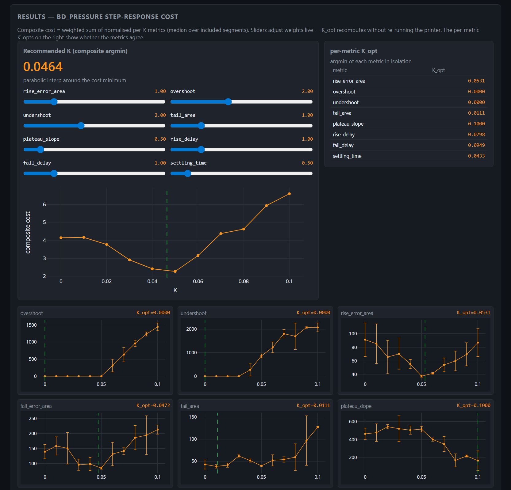
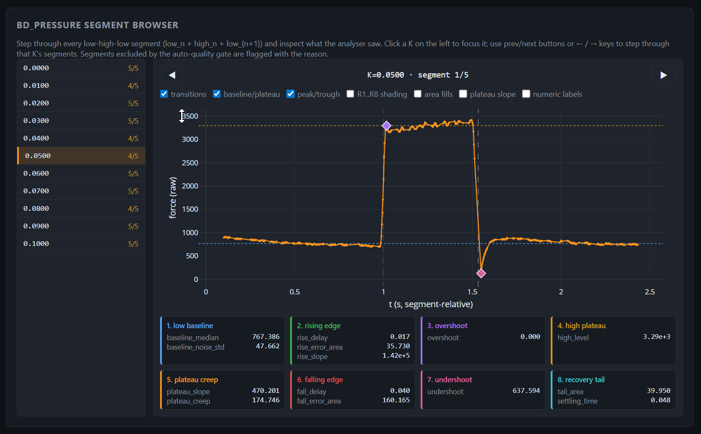

# Prusa PA Tuner

Automatic **Pressure Advance (`M572 S`)** calibration for **Prusa printers with a nozzle
loadcell** (Core One, MK4 / MK4S, MK3.9, XL), using the loadcell as a back-pressure
sensor — no extra hardware, no printed test patches, no eyeballing of corner artefacts.

> **Status:** experimental. Works on current stock Buddy firmware — see
> [Step 0](#step-0--activate-the-metrics-on-the-printer) for how to enable the metrics
> stream the tool relies on.

## Research project

PrusaPATuner is an experimental, non-commercial research tool for investigating
pressure-advance calibration using the Prusa nozzle load cell. It compares several
signal-analysis approaches and is not intended as a commercial printer feature or
production calibration system.



## Why this exists

Pressure Advance is one of the biggest knobs for clean fast prints — it's what stops
corners blobbing and seams over-extruding when the toolhead decelerates into a turn. On
the Core One's direct-drive hotend (and on the MK4-family heads), getting K right means
you can push print speeds without paying for it in corner quality. The conventional
workflow — print a pattern, squint at corners, pick a number — is slow and subjective.

Three projects showed PA can be tuned objectively from a single sensor, without printing
anything:

- **Bambu Lab A1 / A1 mini** — first consumer printer to ship automatic PA calibration
  using its nozzle force sensor: extrude in air, measure back-pressure, sweep K, pick
  the cleanest step response. The whole idea below is downstream of theirs. Bambu hasn't
  open-sourced the algorithm, but the *approach* is what we're reproducing.
- **Snapmaker U1** ([`u1-klipper/flow_calibrator.py`](https://github.com/Snapmaker/u1-klipper/blob/main/klippy/extras/flow_calibrator.py)) —
  open-source implementation using the eddy-current (inductance) coil in its hotend —
  the same coil that serves as its Z probe — to sense extrusion back-pressure as a tiny
  displacement of the metal nozzle assembly, then sweeps K with a slow/fast square-wave
  extrusion in air.
- **markniu's `bd_pressure`** ([github.com/markniu/bd_pressure](https://github.com/markniu/bd_pressure)) —
  open-source strain-gauge module that reads extruder back-pressure directly during a
  planned accel/decel sweep and picks the K that minimises the step-response transient.

Every modern Prusa with a nozzle loadcell already has the sensor needed to do the same
trick. The nozzle assembly is mechanically decoupled from the extruder, so back-pressure
transmitted to it shows up as a Z-force on the cell even with the nozzle in air. This
project combines U1's motion geometry with bd_pressure's step-response analysis, running
on the printer's stock loadcell over UDP.

## Supported printers

- **Prusa Core One** — primary development target.
- **Prusa MK4 / MK4S / MK3.9** — same loadcell, same Buddy firmware family. Should work
  with no changes; community testing very welcome.
- **Prusa XL** — has the loadcell. Multi-tool sequencing is not handled yet, so you'll
  have to manually pick a tool and sweep PA per material.

If your Prusa runs current Buddy firmware and has loadcell-based first-layer
calibration, it has what this tool needs.

### Klipper

Not supported directly — this tool speaks Buddy's G-codes and UDP metrics protocol.
However, [KAPAT](https://github.com/vzagranichnyy/KAPAT) is a community port
([#1](https://github.com/CNCKitchen/PrusaPATuner/issues/1)) that runs the same sweep
and analysis on Klipper: it reads a Mellow ALPS loadcell through Klipper's
`bulk_sensor` API and forwards the samples over UDP in place of Buddy's metrics
stream. Not maintained or tested by this project, but a good starting point if your
printer runs Klipper.

## How it works

1. The tool generates a single G-code job that sweeps K (`M572 S<k>`) across a
   configurable grid. At each K it extrudes an asymmetric slow/fast/slow square-wave in
   air at a safe parking position, with a small XY wiggle so Buddy actually applies PA
   (firmware only honours `M572` on print moves with XY motion — pure E moves are
   ignored).
2. A pre-burst Z-pulse marker plus the streamed toolhead position (`pos_x`/`pos_z`)
   give the analyser an unambiguous time anchor to align planned segments with
   measured force (with a loadcell-based burst detector as last-resort fallback).
3. The job configures metric streaming itself in its G-code preamble — `M334` targets
   your host, `M332` silences the non-essential default streams, `M331` enables
   exactly what the analyser consumes: `loadcell_value` (raw tared grams, ~180 Hz on
   the Core One) plus `pos_x`/`pos_y`/`pos_z`. These arrive over UDP as InfluxDB
   line-protocol metrics while the job runs. See
   [`Prusa-Firmware-Buddy/doc/metrics.md`](https://github.com/prusa3d/Prusa-Firmware-Buddy/blob/master/doc/metrics.md)
   for the protocol.
4. Three analyses run side-by-side on the captured timeseries:
   - **bd_pressure-style step response** — per-segment overshoot, undershoot, settling,
     plateau slope; composite cost minimised across K.
   - **Phase-lag (cross-correlation)** — time-domain shift between commanded velocity
     and measured force. Optimal K is where the lag crosses zero (Ellis 3DP framing:
     under → force lags, over → force leads). The lag response saturates at high K,
     so the crossing comes from a quadratic fit (descending root), with a global
     linear fit as fallback when the sweep never crosses zero.
   - **Integral-area (U1 style)** — integrated centred force across each velocity
     transition; linear fit area-vs-K, solve for zero. Signed rise/fall-area variants
     of the same idea (overshoot ↔ lag flips the sign of the transition area) run
     alongside it and are shown as their own K_opt estimates.
5. The web UI plots every intermediate signal (raw force, segments, per-K metrics,
   composite cost) so you can sanity-check before trusting the number.

## Requirements

- A Prusa printer with a nozzle loadcell and current Buddy firmware (see
  [Supported printers](#supported-printers)).
- **PrusaLink** enabled with Digest credentials (user `maker` plus the auto-generated
  password under Settings → Network → PrusaLink on the touchscreen).
- **Wired Ethernet strongly recommended.** Prusa's onboard WiFi is fragile — packets get
  dropped under load and runs come back corrupted. If you absolutely must use WiFi,
  **point the printer's antenna directly at your access point** and keep them close.
  A LAN cable solves it outright.
- The printer must be able to reach the host over **UDP/8514** — same LAN is the
  simple case, routed subnets work too — and the host firewall must permit
  **inbound UDP/8514**. **On Windows this almost always needs a one-time firewall
  fix run from an *admin* PowerShell** — see
  [Windows firewall — fix it in an admin PowerShell](#windows-firewall--fix-it-in-an-admin-powershell)
  before your first run.
- **Python 3.11+** on the host.

## Install

```bash
git clone https://github.com/CNCKitchen/PrusaPATuner
cd PrusaPATuner
python -m venv .venv
# Windows:
.venv\Scripts\activate
# macOS / Linux:
source .venv/bin/activate

pip install -e .
```

> **Windows:** see [`docs/SETUP-WINDOWS.md`](docs/SETUP-WINDOWS.md) for a
> battle-tested walkthrough — including two `pip install -e .` build errors on
> modern setuptools (fixed in the repo, documented there), why you must stop the
> app before re-running `pip install` in the venv, and a firewall diagnosis that
> catches silent packet drops the app itself can't see.

## Step 0 — activate the metrics on the printer

Buddy's metrics subsystem is off by default. On the printer touchscreen, open the
**Metrics & Log** settings (Settings → Network → Metrics & Log), **enable metrics**,
enter the **IP of the computer running this tool** as the host, and set both the
metrics and syslog ports to `8514`. `prusa-pa-tuner` prints the LAN IP it thinks the
printer should target on startup — use that.

You do **not** need to enable individual metrics by hand. Every generated job
configures its own streaming in the G-code preamble: `M334` (re)targets your host,
`M332` silences the low-rate default metrics (the metrics throttle on Buddy is
compile-time, and every extra active stream eats into the UDP budget — fewer is
faster), and `M331` enables exactly the streams the analyser consumes
(`loadcell_value`, `pos_x`, `pos_y`, `pos_z`).

> **Metric state is RAM-only.** `M331`/`M332`/`M334` settings revert on every power
> cycle. The generated jobs re-apply them at the start of each run, so this is
> normally invisible — but if packets stop after a printer reboot, re-check the
> Metrics & Log settings on the touchscreen first.

> **Why the tool doesn't trust ad-hoc `M331` over PrusaLink:** Buddy silently no-ops
> on unknown metric names — the "Metric not found" reply goes to the serial console
> only, so over PrusaLink you can't tell what actually got enabled. The generated
> jobs only enable names verified to exist on current Core One firmware.

Then run `scripts/sniff.py` from the host to confirm packets are actually arriving:

```powershell
python scripts/sniff.py --prusalink-host <printer-IP> --password <PrusaLink-password> --log capture.log
```

In this mode `sniff.py` enables a diagnostic metric set itself over PrusaLink (and
disables it again on Ctrl-C). You should at minimum see `loadcell_value` ticking at
~180 Hz. Several loadcell-family metrics (`loadcell_hp` among them) are registered in
the firmware but silent on current stock builds — don't worry if they stay at 0 Hz.
If everything is silent, check (in order):

- the printer's Metrics & Log host IP matches your host's LAN address,
- inbound UDP/8514 is allowed by the host firewall (on Windows see the firewall
  section below — the fix needs an **admin** PowerShell),
- metrics are still enabled on the touchscreen (see above).

### Windows firewall — fix it in an admin PowerShell

> **If the app looks healthy but Diagnostics shows `packets: 0`, this is almost
> certainly the Windows firewall — and the fix MUST be run from an *elevated
> (admin)* PowerShell.** A regular shell can diagnose the problem, but gets
> *Access denied* when it tries to change the rules. Right-click Start →
> "Terminal (Admin)".

The mechanism, and why nothing *looks* wrong:

- Whenever a Windows firewall prompt for Python gets dismissed (Esc, or the
  popup times out unnoticed), Windows creates an **enabled inbound *Block*
  rule** bound to that exact python.exe path. It stays there forever.
- **Block beats Allow.** Even a correct port-based rule like "allow UDP 8514" is
  overridden by that program-level Block rule. Every printer packet then reaches
  your PC and dies at the firewall — while loopback tests still pass, so the app
  itself looks fine.
- A venv's python.exe is only a launcher: the **base** interpreter is the
  process that binds the socket, so the base python.exe's firewall rules are the
  ones that count.
- The auto-created Block rules are often scoped to the **Public** profile — and
  Windows classifies most WiFi networks as Public by default, so they very
  likely apply to your LAN.

**Step 1 — diagnose** (regular PowerShell is fine):

```powershell
Get-NetFirewallApplicationFilter | Where-Object { $_.Program -like '*python*' } |
  ForEach-Object { $r = $_ | Get-NetFirewallRule;
    "{0} | enabled={1} action={2} profile={3} prog={4}" -f
      $r.DisplayName, $r.Enabled, $r.Action, $r.Profile, $_.Program }
```

Any line with `enabled=True action=Block` pointing at your current Python is the
problem.

**Step 2 — fix, in an *admin* PowerShell** (a regular one will fail):

```powershell
Get-NetFirewallApplicationFilter |
  Where-Object { $_.Program -like '*python*' } |
  Get-NetFirewallRule | Where-Object { $_.Action -eq 'Block' } |
  Set-NetFirewallRule -Action Allow
```

Match on the program path as shown — don't filter on `-DisplayName 'Python'`,
because the auto-created rules are typically named `python.exe`, not `Python`.
GUI alternative: Windows Security → Firewall & network protection → *Allow an
app through firewall* → tick **all** checkboxes (including *Public*) for the
Python entries.

Packets should start flowing within seconds — watch the `packets` counter in the
app's Diagnostics panel.

#### Store Python: the fix un-does itself after every Python update

If you run the Microsoft Store Python, expect to repeat the fix after every
auto-update: Store Python updates into a *new versioned folder*
(`...\PythonSoftwareFoundation.Python.3.13_3.13.XXXX.0_x64_...\python3.13.exe`),
so your old Allow rule no longer matches the new path, Windows shows a fresh
prompt, and a dismissed prompt creates a fresh Block rule. A version-independent
inbound rule for `UDP 8514` does **not** protect you — the per-program Block
rule still wins. The python.org installer keeps a stable path and avoids the
churn entirely.

Full protocol reference: [`Prusa-Firmware-Buddy/doc/metrics.md`](https://github.com/prusa3d/Prusa-Firmware-Buddy/blob/master/doc/metrics.md).

## Run the app

```bash
prusa-pa-tuner
# or
python -m prusa_pa_tuner
```

A browser opens at <http://127.0.0.1:8765/>.

1. **Printer** — enter the printer's IP and PrusaLink password.
2. **Filament & temps** — material label, nozzle temp, bed temp.
3. **Sweep parameters** — defaults match bd_pressure's granularity:
   K from 0.00 to 0.10 in 0.002 steps, slow 1.92 mm³/s × 1.0 s, fast 19.24 mm³/s ×
   0.25 s, 14 cycles per K, accel 5000 mm/s². Tighten the K range once you know roughly
   where your filament lands.
4. **Start tuning run.** The app will:
   - Detect this host's LAN IP toward the printer.
   - Generate the sweep G-code (Preview button shows it).
   - Upload via PrusaLink, start the print.
   - Stream loadcell timeseries live to the chart.
   - Analyse on job-end and surface K_opt from every estimator side-by-side.
5. **Copy `M572 S…`** to paste into your slicer's filament profile.

The bd_pressure composite cost is live-re-weightable: sliders adjust the per-metric
weights and the cost curve updates instantly. You can also annotate a run with your
own known-good K and let the built-in weight optimiser fit the weights to it.

Raw run data is saved to `runs/run_<timestamp>.npz` (gitignored by default). Use
`scripts/replay_run.py` to re-analyse old runs without re-printing.

### macOS: Dock / desktop launcher (optional)

If you'd rather double-click an icon than keep a terminal open, build a small
launcher app once the install above is done:

```bash
scripts/make_macos_app.sh --desktop
```

This creates `~/Applications/Prusa PA Tuner.app` (and, with `--desktop`, a shortcut
on the Desktop). Double-clicking it starts the server from this checkout's `.venv`
and opens the UI in your default browser; clicking the Dock icon opens the UI
again; quitting the app (Cmd+Q) stops the server. Closing the browser tab does
*not* stop it. Server output goes to `~/Library/Logs/PrusaPATuner.log`.

The app is a thin wrapper around this checkout, not a standalone bundle — if you
move the folder or recreate the venv, run the script again. It only uses tools
that ship with macOS.

## Beyond PA: the other modules

The web UI has four modes, toggled at the top of the page. All of them reuse the
same metric-streaming and run/replay machinery as the PA sweep, and all are
experimental pending broader hardware testing:

- **PA Tuning** — the K sweep described above.
- **Max Flow** — free-air stepped flow-rate ramp; estimates the hotend's maximum
  volumetric flow from loadcell back-pressure (sub-linear power-law fit,
  variance-rise and collapse detection) instead of squinting at extrusion quality.
- **Live Map** — maps loadcell force onto a 2D preview of the G-code during a real
  print, per layer, so you can see *where in the part* extrusion pressure spikes.
- **Touch Probe** — lateral ±X/±Y sensitivity characterization: how much of a
  sideways nozzle contact does the (axial) loadcell actually see?

## Algorithm notes

The "tune PA from the nozzle force sensor" idea originates with **Bambu Lab's A1
series** — their stock auto-calibration was the first consumer demonstration. The
algorithm isn't open, but the geometry and analysis pieces below are.

The square-wave-in-air motion is taken from
[Snapmaker U1](https://github.com/Snapmaker/u1-klipper/blob/main/klippy/extras/flow_calibrator.py):
their flow calibrator reads an eddy-current (inductance) coil in the hotend — the same
coil the U1 uses as its Z probe — whose oscillation frequency shifts as extruder
back-pressure displaces the metal nozzle assembly by a tiny amount. On a Prusa, the
same back-pressure is transmitted through the decoupled nozzle assembly and shows up
as a Z-force on the loadcell — the same dynamic signature read by a different sensor
(force vs displacement).

The step-response decomposition (rising-edge overshoot, plateau slope, falling-edge
undershoot, settling, etc.) is adapted from
[markniu's `bd_pressure`](https://github.com/markniu/bd_pressure). bd_pressure ships its
own strain-gauge sensor and runs the analysis in real time on a Klipper host; we run the
same conceptual analysis offline on the captured UDP timeseries.



The segment browser above is a debug view of one cycle at K=0.05: you can scrub through
every K and every segment, and see exactly which numbers the analyser pulled out of each
burst. This is the "show your work" surface that makes K_opt verifiable instead of a
black box — if a K looks wrong, click into its segments and find out why.

The analyser runs on `loadcell_value`, the raw tared force stream (~180 Hz on the
Core One), with software detrending to strip the static baseline (tool weight +
sensor drift) and leave just the grams-scale dynamic component PA actually modulates.
Buddy also registers a firmware-highpassed `loadcell_hp` metric that would be the
natural input, but it is silent on current stock firmware builds, so the tool doesn't
subscribe to it.

Physics intuition (under-comp K → force lags command, optimal K → in phase, over-comp K →
force leads) follows the
[Ellis 3DP Pressure/Linear Advance guide](https://ellis3dp.com/Print-Tuning-Guide/articles/pressure_linear_advance/introduction.html).

We run all of the estimators side-by-side because it isn't yet established which one
gives the most trustworthy answer on real Prusa loadcell data. Open issues with
`runs/*.npz` attached welcomed.

## Project layout

```
src/prusa_pa_tuner/
  app.py            # FastAPI app + websocket runner
  config.py         # persistent user config (lives outside the repo)
  gcode_gen.py      # generates the K-sweep .gcode
  gcode_preamble.py # shared printer preamble used by all four generators
  prusalink.py      # PrusaLink REST client (Digest + legacy X-Api-Key)
  udp_metrics.py    # async UDP listener + parser + firmware-clock mapper
  analysis.py       # bd_pressure + phase-lag + integral/signed-area metrics
  alignment.py      # sweep_t0 anchoring + per-K window slicing
  optimiser.py      # composite-cost weight optimiser (fit weights to a known K)
  runner.py         # end-to-end orchestration (PA sweep)
  run_lifecycle.py  # shared runner machinery (poll loop, collectors, dumps)
  sampling.py       # shared metric-sample extraction helpers
  flow_*.py         # Max Flow module (gen/runner/analysis)
  livemap_*.py      # Live Map module
  gcode_parse.py    # G-code parser for the Live Map preview
  probe_*.py        # Touch Probe module
  netutil.py        # detect local IP toward the printer
  replay.py         # offline replay of saved runs/*.npz
  export.py         # xlsx export of run data
  static/           # web UI (vanilla HTML + Plotly + JS)
scripts/
  sniff.py          # standalone UDP sniffer (go/no-go gate)
  replay_run.py     # CLI: replay a saved run through the analyser
  diagnose.py       # one-shot extrude + UDP capture for triage
  check_loadcell.py # PrusaLink metric-availability probe
  examine_sg.py     # stationary-extrude force capture
  npz2xlsx.py       # convert a saved run .npz to a spreadsheet
  bootstrap_sanity.py # sanity checks for the optimiser's segment bootstrap
  make_macos_app.sh # build the optional macOS launcher app
packaging/macos/    # launcher applet source + icon for make_macos_app.sh
tests/              # pytest
```

User-specific config (printer IP, PrusaLink password) is stored *outside the repo* at
`%APPDATA%/PrusaPATuner/config.json` on Windows or `~/.prusa_pa_tuner/config.json`
elsewhere, and is loaded/saved by the web UI. Nothing printer-identifying is committed
back into the working tree.

## License

Released under the **GNU Affero General Public License v3.0 or later** — see
[`LICENSE`](LICENSE).

The AGPL choice is deliberate: if you run a modified version of this tool as part of a
hosted service (e.g. a cloud calibration service for someone else's printer), you must
make your modifications available to that service's users.

## Acknowledgements

- **Bambu Lab A1 / A1 mini** — original consumer-printer demonstration of nozzle-
  force-based automatic PA calibration; the conceptual starting point for everything
  below.
- [Snapmaker U1 Klipper](https://github.com/Snapmaker/u1-klipper) — flow calibrator
  motion geometry and integral-area math.
- [markniu/bd_pressure](https://github.com/markniu/bd_pressure) — step-response
  decomposition and composite-cost K selection.
- [vzagranichnyy/KAPAT](https://github.com/vzagranichnyy/KAPAT) — community Klipper
  port of this tool using a Mellow ALPS loadcell and Klipper's `bulk_sensor` API.
- [Ellis 3DP Print Tuning Guide](https://ellis3dp.com/Print-Tuning-Guide/articles/pressure_linear_advance/introduction.html)
  — physics framing and PA intuition.
- [Prusa firmware-specific G-code reference](https://help.prusa3d.com/article/prusa-firmware-specific-g-code-commands_112173)
  — canonical source for what Buddy actually accepts.
- [Prusa-Firmware-Buddy `doc/metrics.md`](https://github.com/prusa3d/Prusa-Firmware-Buddy/blob/master/doc/metrics.md)
  — UDP metrics protocol and the canonical list of available metric names.
